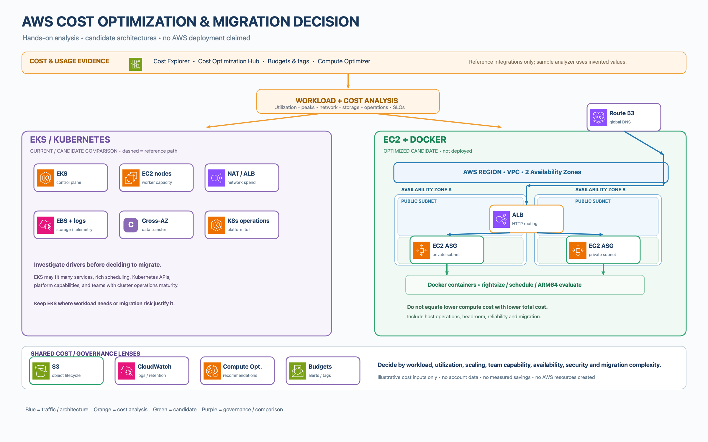

# AWS Cost Optimization & Infrastructure Migration Platform

**Hands-on portfolio project** for examining AWS cost drivers and making workload-dependent architecture decisions.

> AWS infrastructure is not deployed by default. No production migration or AWS savings are claimed. Cost figures are illustrative unless explicitly identified as measured data; this repository contains no actual billing export.

## Problem and architecture

Analyze cost and workload evidence before choosing alternatives. EKS and EC2/Docker are candidates, not winners by fiat. EC2 Auto Scaling is an optimized candidate only, not deployed.

See architecture/architecture.md and docs/architecture-comparison.md. AWS service marks use the approved icon toolkit from [AWS Architecture Icons](https://aws.amazon.com/architecture/icons/); the diagram is rendered by architecture/render.swift.

## Repository layout

    tools/          Python analyzer and tests
    examples/       labelled cost assumptions
    app/            local Node.js health/version API
    docker/         before and optimized image examples
    terraform/      AWS learning/reference configuration
    architecture/   rendered diagram, source and AWS icons
    docs/           cost, selection, migration and interview guides

## Hands-on and reference scope

Local hands-on: Python analyzer and sample assumptions, health/version API, Dockerfiles, Buildx command, decision framework and Terraform fmt/validate where provider setup permits. Cost Explorer, Cost Optimization Hub, Compute Optimizer, Budgets, production migration and Graviton conversion are reference-only.

## Analyzer

    python3 tools/cost_analyzer.py examples/resources.json
    python3 -m unittest discover -s tools -p test_cost_analyzer.py -v

Sample data is explicitly labelled ILLUSTRATIVE_SAMPLE_NOT_AWS_BILL. Results are arithmetic over assumptions, not a quote or measured saving. The cost-model YAML provides a second editable scenario, also illustrative.

## Local API

    cd app
    node src/server.js

In another terminal, run curl localhost:3000/health and curl localhost:3000/version. Stop with Ctrl-C. The API uses no AWS account.

## Docker and ARM64

    docker build -f docker/before/Dockerfile -t cost-demo:before .
    docker build -f docker/optimized/Dockerfile -t cost-demo:optimized .
    docker image ls cost-demo
    docker buildx build --platform linux/amd64,linux/arm64 -f docker/optimized/Dockerfile -t cost-demo:multi --output=type=oci,dest=/tmp/cost-demo.oci.tar .

Compare actual local sizes; no measurements are preclaimed. Docker daemon required. The OCI archive output supports both platforms without loading a multi-platform manifest into the local image store. Test dependencies and behavior on ARM64 before considering Graviton.

## Terraform reference

    cd terraform
    terraform fmt -recursive
    terraform init -backend=false
    terraform validate

Do not run terraform apply. This sketch is not production-ready; see terraform/README.md. The reference includes VPC/subnets, ALB, Auto Scaling, an empty EC2 role, encrypted/versioned S3 and CloudWatch retention. Private subnets intentionally have no NAT route.

## Guides

- docs/architecture-comparison.md — EKS and EC2/Docker trade-offs
- docs/migration-plan.md — assess through cost validation
- docs/migration-risks.md — detection, mitigation and rollback
- docs/cost-optimization-checklist.md — review checklist
- docs/cost-model.md — assumptions and formulas
- docs/cost-governance.md — tags, budgets and ownership
- docs/service-selection.md — network, storage, monitoring, messaging and compute choices
- docs/docker-optimization.md — image and ARM64 exercise
- docs/interview-guide.md — engineering reasoning

## Security and limitations

No credentials, private keys, .env secrets or billing exports belong here. Terraform state and variable files are ignored. Example tags do not imply account configuration. No AWS resources have been created; no production savings, migration, Docker size comparison or ARM64 result is claimed unless actually measured.

## Local validation record

- Python analyzer: ran with the labelled synthetic data; two unit tests passed.
- Demo API: local /health, /version and not-found responses checked.
- Docker: before and optimized images built; optimized container returned healthy/version responses on the local arm64 engine. Measured size details and comparison caveat are in docs/docker-optimization.md.
- Buildx: linux/amd64 and linux/arm64 OCI archive build completed; amd64 runtime behavior was not tested.
- Terraform: recursive formatting and terraform validate passed after provider initialization. terraform apply was not run.
- Gitleaks directory scan: no findings. Markdown local links and JSON syntax checked.
- No AWS resource was created.
